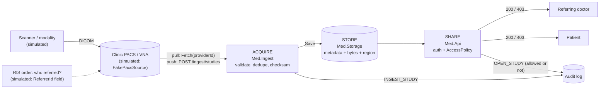
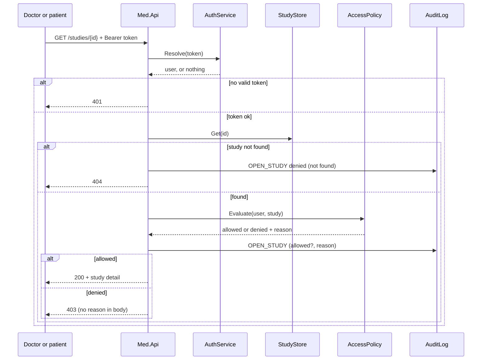

# Data flow

All of this is a model for learning. Boxes marked *(simulated)* stand in for real clinic systems.

## 1. The big picture

## 2. Opening a study (the most important request)

## 3. Access rules (AccessPolicy)

1. **Region first.** User's region must equal the study's region (data residency).
2. **Referrer:** only the referrer of record.
3. **Patient:** only their own studies.
4. **Provider:** only studies from their own clinic.

Anything else is denied. Rules are checked in that order, so a region mismatch beats everything.

## 4. Where trust boundaries sit

| Boundary | Why it matters |
|---|---|
| Clinic network → platform | Data leaves a closed network. Must be authenticated and encrypted in a real system |
| Internet → API | Every endpoint must check identity (401) and permission (403) |
| Region → region | Data residency: studies must not be served across regions |
| Stored bytes → viewer | Integrity: what the doctor sees must be exactly what the scanner produced |

## 5. Where bugs would hurt most (feeds the test plan)

- Ingest assigns the wrong region, or the wrong referrer, so the wrong person sees the study.
- Re-running ingest duplicates studies, so a doctor sees the same scan twice and reports get confused.
- An error response leaks patient details.
- Stored bytes change (silent corruption) and nobody notices.
- A denied attempt is not logged, so a breach cannot be investigated.
